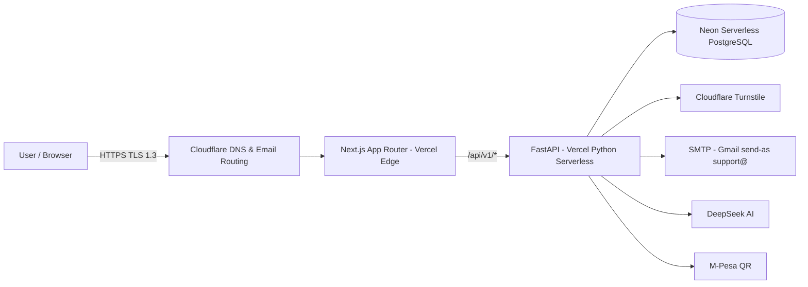
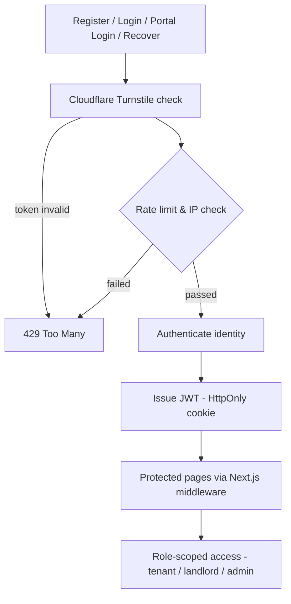
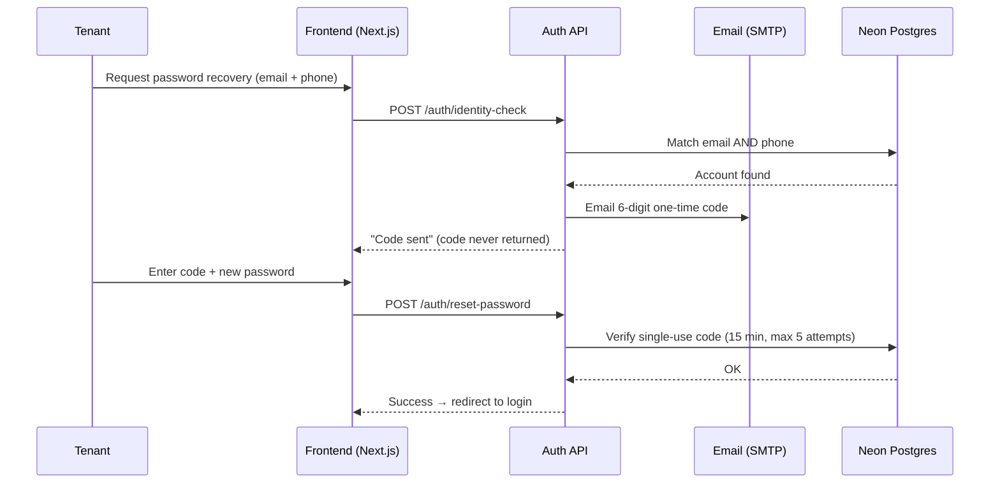

<p align="center">
  
</p>

<h1 align="center">Tuiyabelong — Rental Management System (RMS)</h1>

<p align="center">
  Production-ready rental property management built for Kenyan landlords and tenants.
</p>

<p align="center">
  🌐 <a href="https://www.tuiyabelong.com"><strong>www.tuiyabelong.com</strong></a>
</p>

<p align="center">
  
  
  
  
  
  
</p>

---

## What is RMS?

RMS (marketed as **Tuiyabelong**) is a complete web platform that lets a rental property
owner run their entire estate from one place, while giving tenants a self-service portal
for the things they normally queue at the office for.

It started as a monolith with a separate portal per role and evolved into a modern
**hybrid deployment**: a **Next.js 14** frontend and a fully async **FastAPI** backend,
living together on **Vercel**'s edge, backed by **Neon** serverless PostgreSQL, fronted and
email-covered by **Cloudflare**.

### Who it is for

| Role | What they get |
|------|---------------|
| **Tenant** | View their property & unit, pay rent, report maintenance, raise messages, receive notifications, download documents |
| **Landlord** | Dashboard, tenant management, payment/mpesa tracking, maintenance, utilities (water & Wi-Fi), financial reports |
| **Admin** | System-wide overview, tenant & property management, finance (KRA tax settings), system health & monitoring |

### Core capabilities

- **Payments** — tenants pay via M-Pesa and flag their payment for verification; landlords approve. Rent tracking with arrears.
- **Utilities** — water/Wi-Fi billing per unit, statements, and profit summaries.
- **Maintenance** — tenants log issues, landlords/admin triage and update status.
- **Communications** — in-app messages, notifications, and shared documents.
- **Reporting** — financial reports with an **AI-generated narrative** (DeepSeek) that explains the numbers.
- **Tax** — configurable KRA income tax and county rate settings with monthly deductions.

---

## Architecture







---

## Technology Stack

### Frontend — Next.js 14
- App Router + TypeScript, Tailwind CSS design system
- Zustand, React Hook Form + Zod validation
- JWT in HttpOnly cookies with route-guard middleware, PWA (service worker + manifest)

### Backend — FastAPI (async)
- Python 3.11+, SQLAlchemy 2.0 async + asyncpg
- Pydantic schemas, bcrypt hashing, JWT (HS256) auth
- Background scheduler (rent reminders, backups), Vercel Cron trigger
- DeepSeek (financial narratives), M-Pesa verification, SMTP email

### Data — Neon serverless PostgreSQL
- Pooled, async driver (asyncpg), schema created idempotently at startup
- Production and development share the managed database

### Infrastructure
- **Vercel** hybrid deployment — Next.js edge + Python serverless functions (`vercel.json` rewrites `/api/v1/*` to `api/main.py`)
- **Cloudflare** — DNS, TLS 1.3 minimum, email routing (`support@tuiyabelong.com`)
- **SMTP** — Gmail "send mail as" alias for outbound mail

---

## Security Structure

The system is hardened by design. Highlights of what is implemented:

### Authentication & identity
- **Cloudflare Turnstile** human verification on registration, login, portal login, and recovery
- **JWT in HttpOnly cookies** for sessions; access token expiry enforced
- **bcrypt** password hashing
- **Role-based access** — registration is locked to `tenant`; landlord/admin access is granted separately; portal routes are protected server-side
- **No default secrets** — the API fails fast at startup if `SECRET_KEY` is not configured

### Account recovery
- Recovery requires the **email AND phone** on the account to match
- A **6-digit one-time code is emailed** to the account's address (never shown on screen)
- Code is **single-use, 15-minute expiry, max 5 attempts** before lockout
- Generic 403 responses avoid user enumeration on the identity check

### Application defense
- **Rate limiting** with exponential backoff on auth endpoints (login, reset, recovery, portal)
- **Strict CORS allowlist** (no wildcard origins)
- **Security headers** on every response:
  - `Content-Security-Policy` (incl. `frame-ancestors 'none'`) and `X-Frame-Options: DENY`
  - `HSTS` (2-year, includeSubDomains, preload-ready), `X-Content-Type-Options: nosniff`
  - `Referrer-Policy: strict-origin-when-cross-origin`, `Permissions-Policy`, `COOP`, `CORP`
- **`robots.txt`** blocks `/admin`, `/landlord`, `/api/`, `/docs`; admin/landlord raw paths return 404
- **Input validation** on both layers — Zod (client) and Pydantic (server)
- **Terms-of-service acceptance** recorded per user (versioned)

### Mail deliverability
- SPF includes Google + Cloudflare; DMARC `p=none` with reporting; verified "send-as" for `support@tuiyabelong.com`

---

## API Overview

Base path: `/api/v1`

| Module | Endpoints |
|--------|-----------|
| Auth | register, login, portal-login, forgot-password, **identity-check**, reset-password, me |
| Users | contacts, profile-photo |
| Properties | `/properties`, `/properties/my` |
| Tenants | available-units, assign-room, my-status |
| Payments | my, all, recent, verify-mpesa |
| Maintenance | my, all, create, status update |
| Utilities | create/list, profit-summary, statement per unit, update/delete |
| Notifications | list, create, mark read |
| Messages | inbox, sent, send, update/delete |
| Documents | my, list |
| Leases / Arrears | lease & arrears tracking |
| Monitoring | health, status, ping |
| Reports | financial reports + AI narrative |
| Admin | stats, tenants (view/delete), **public-stats**, **tax-settings** |

---

## Local Development

```bash
# Backend
cd backend
python -m venv .venv
pip install -r requirements.txt
# populate backend/.env (DATABASE_URL + secrets — values are gitignored, never committed)
uvicorn app.main:app --reload --port 8000

# Frontend
cd frontend
npm install
npm run dev   # http://localhost:3000
```

Environment variables are managed per-environment and never stored in the repository.

---

## Deployment

- **CI** — every push to `main` auto-deploys on Vercel.
- **Routing** — `vercel.json` sends `/api/v1/*`, `/api/*`, `/health`, `/robots.txt`, `/sitemap.xml` to the Python function; everything else is served by Next.js.
- **Database** — Neon PostgreSQL schema is created/updated idempotently at startup.
- **Domain** — `www.tuiyabelong.com` served through Cloudflare (TLS 1.3 minimum) → Vercel origin.

## License

MIT — see [LICENSE.md](LICENSE.md).