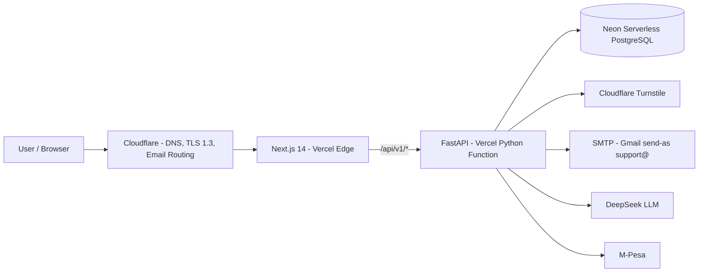
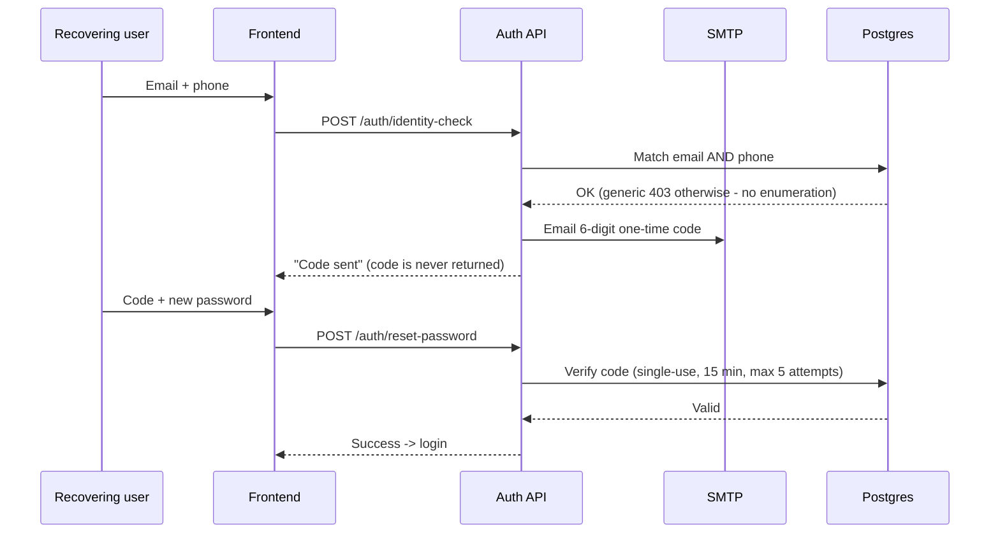

# Rental Management System (RMS) — "Tuiyabelong"

**System Documentation Report**

| | |
|---|---|
| **System** | Rental Management System (RMS) |
| **Product brand** | Tuiyabelong |
| **Public URL** | <https://www.tuiyabelong.com> |
| **Author** | Daniel Manyasa |
| **Document version** | 1.0 |
| **Classification** | Internal / Client-facing |

---

## Chapter 1 — Executive Summary

Rental Management System (RMS) is a production-grade, cloud-hosted web platform that
digitises the day-to-day running of rental property for landlords in Kenya. It replaces
paper ledgers, queue-based rent collection and phone-call maintenance reporting with a
self-service web experience for tenants, a full management dashboard for landlords, and
a system-wide operations console for administrators.

The system is delivered as a **hybrid deployment** on Vercel: a Next.js 14 frontend and an
async FastAPI backend are served from the same project, with edge rewrites routing API
traffic to Python serverless functions. Data lives in a **Neon serverless PostgreSQL**
database. The public domain `www.tuiyabelong.com` is fronted by **Cloudflare**, which
provides DNS, TLS termination at a 1.3 minimum, and inbound email routing for
`support@tuiyabelong.com`.

Key outcomes delivered:

- Three role-specific portals (tenant, landlord, admin) behind one unified auth system.
- M-Pesa rent payments with landlord verification and automatic arrears tracking.
- Billing and profit analysis for utilities (water & Wi-Fi).
- Financial reporting with AI-generated narrative summaries.
- A deliberately hardened security posture (Cloudflare Turnstile, HttpOnly JWT, email OTP
  account recovery, rate limiting, strict security headers).
- Fully automated deployment: every push to `main` deploys to production.

---

## Chapter 2 — Product Overview

### 2.1 What the system does

RMS gives a rental owner a single source of truth for their properties, units, tenants,
payments, maintenance, and utilities. Tenants get real self-service: they see their
property and unit details, pay rent, log maintenance issues, send and receive messages,
and access documents without visiting an office.

### 2.2 Users and portals

| Portal | Audience | Highlights |
|---|---|---|
| **Tenant Portal** | Renters | View property/unit, pay rent via M-Pesa, raise maintenance tickets, messages, notifications, documents |
| **Landlord Portal** | Property owner(s) | Dashboard KPIs, tenant management, payment verification & arrears, maintenance triage, utility billing, financial reports |
| **Admin Portal** | System administrators | Cross-property overview, tenant & property administration, KRA tax configuration, system health & monitoring |

### 2.3 Core feature modules

- **Payments** — tenant-initiated M-Pesa payments flagged for verification; landlord approves and the ledger updates; arrears are computed automatically.
- **Utilities** — water and Wi-Fi charges posted per unit, statements per unit, profit summaries.
- **Maintenance** — tenant-reported issues with lifecycle status tracking.
- **Messaging & notifications** — internal inbox, sent mail, read tracking, and push-style notifications.
- **Documents** — shared documents visible to tenants.
- **Reporting** — financial reporting with a DeepSeek-generated narrative explaining trends.
- **Taxation** — configurable KRA income-tax rate and county rates applied at the property level.

---

## Chapter 3 — System Architecture

### 3.1 High-level architecture

The application follows a classic three-tier web model with a modern twist: both the
presentation and API tiers ship as one Vercel project.

### 3.2 Request lifecycle

1. The browser reaches `https://www.tuiyabelong.com` through Cloudflare.
2. Static and client-rendered routes are served by Next.js on the Vercel edge network.
3. Browser calls starting with `/api/v1/*` are rewritten by `vercel.json` to the Python
   serverless function (`api/main.py`).
4. FastAPI validates, authorises, and executes the request against Neon PostgreSQL.
5. External services (SMTP, DeepSeek, Turnstile, M-Pesa) are invoked as needed.
6. The JSON response is returned; security headers are applied by middleware.

### 3.3 Deployment topology

- **Hosting**: Vercel (single project, hybrid Next.js + Python).
- **Edge**: Cloudflare in front of Vercel; minimum TLS 1.3.
- **Database**: Neon serverless PostgreSQL via pooled async connections (asyncpg).
- **Email**: SMTP through Gmail's "Send mail as" alias for `support@tuiyabelong.com`,
  routed inbound via Cloudflare Email Routing.

---

## Chapter 4 — Technology Stack

### 4.1 Frontend

| Concern | Technology |
|---|---|
| Framework | Next.js 14 (App Router) |
| Language | TypeScript |
| Styling | Tailwind CSS + custom design system |
| State / forms | Zustand, React Hook Form, Zod |
| Auth storage | JWT in HttpOnly cookies + route-guard middleware |
| PWA | Service worker, web manifest, app icons |

### 4.2 Backend

| Concern | Technology |
|---|---|
| Framework | FastAPI (asynchronous) |
| Language | Python 3.11+ |
| ORM | SQLAlchemy 2.0 (async) + asyncpg |
| Validation | Pydantic schemas |
| Auth | JWT (HS256), bcrypt hashing |
| Scheduled jobs | APScheduler background scheduler + Vercel Cron |
| Integrations | M-Pesa (Safaricom), DeepSeek API, SMTP email, Cloudflare Turnstile |

### 4.3 Data & infrastructure

| Concern | Technology |
|---|---|
| Database | Neon serverless PostgreSQL (pooled) |
| Cache | Experimental in-app cache service |
| DNS / edge | Cloudflare |
| CDN / hosting | Vercel |
| Email | Gmail SMTP (send-as alias `support@tuiyabelong.com`) |

---

## Chapter 5 — Security Architecture

Security is treated as an explicit layer rather than an afterthought. This chapter
describes what has been implemented.

### 5.1 Identity & authentication

- **Cloudflare Turnstile** is enforced on registration, login, portal login, and account
  recovery. It runs in a non-interactive mode where possible to avoid hurting UX.
- Sessions use **JWT access tokens delivered in HttpOnly cookies**, so client-side
  JavaScript cannot read the token.
- Passwords are stored as **bcrypt hashes**.
- **Role-based access control**: users are bound to a role (`tenant`, `landlord`,
  `admin`); self-registration can only create tenant accounts, eliminating privilege
  escalation via the sign-up form.
- **No default secrets**: the API refuses to start without an explicit `SECRET_KEY`
  in non-development environments.

### 5.2 Account recovery flow (email OTP)

Recovery no longer relies on emailed links or on-screen codes.

### 5.3 Application-layer defenses

- **Rate limiting** with exponential backoff and per-IP windows on authentication
  endpoints (login, reset, recovery, portal login).
- **Strict CORS allowlist** — no wildcard origins; production and staging origins are
  explicitly enumerated.
- **Security headers** applied by middleware on every response:
  - `Content-Security-Policy` (including `frame-ancestors 'none'`, `base-uri 'self'`,
    `form-action 'self'`, `object-src 'none'`)
  - `X-Frame-Options: DENY` (clickjacking protection)
  - `Strict-Transport-Security` — 2 years, includeSubDomains, preload
  - `X-Content-Type-Options: nosniff`
  - `Referrer-Policy: strict-origin-when-cross-origin`
  - `Permissions-Policy` (camera, microphone, geolocation, payment disabled)
  - `Cross-Origin-Opener-Policy` and `Cross-Origin-Resource-Policy`
- **robots.txt** disallows `/admin`, `/landlord`, `/api/`, `/docs`, `/redoc`, OpenAPI;
  raw `/admin` and `/landlord` paths return 404.
- **Input validation** on both tiers (Zod on the client, Pydantic on the server).
- **Terms-of-service acceptance** is recorded per user with a version stamp.

### 5.4 Mail & domain posture

- SPF record covers both Google and Cloudflare senders.
- DMARC policy adopted at `p=none` with aggregate reports while DKIM alignment matures.
- Outbound mail is sent with a verified Gmail "Send mail as" alias so recipients see
  `support@tuiyabelong.com`.

### 5.5 Secrets management

- Sensitive configuration (database URL, JWT secret, SMTP app password, API keys) is
  managed through environment variables — locally in a gitignored `.env` and in Vercel's
  environment-variable store for production. Nothing sensitive is committed to source.

---

## Chapter 6 — Data Model & Persistence

### 6.1 Database platform

Neon serverless PostgreSQL. The application connects through a **pooled** endpoint with
SQLAlchemy's async driver (asyncpg). Configuration normalises provider connection strings
so that pooled serverless endpoints work with prepared-statement caches disabled — a
requirement of PgBouncer-style pooling.

### 6.2 Schema management

Schema is handled idempotently: on application startup `ensure_tables` creates missing
tables without altering existing ones. Structural changes to already-deployed tables are
applied through targeted `ALTER` statements, keeping a shared database between
development and production consistent.

### 6.3 Core entities

| Entity | Purpose |
|---|---|
| **User** | People (tenants, landlords, admins) — auth fields, role, phone, terms acceptance, recovery-pin state |
| **Property / Unit** | Buildings and rentable units |
| **Tenant** | Occupancy records linking users to units |
| **Lease** | Tenancy terms and periods |
| **Payment** | Rent payments and M-Pesa verification state |
| **Arrears** | Computed outstanding balances |
| **Maintenance** | Tenant-reported issues and status lifecycle |
| **Utility** | Water/Wi-Fi billing, statements, profit summaries |
| **Message / Notification** | Internal communications |
| **Document** | Shared files |
| **PasswordResetToken** | Legacy token records (superseded by email OTP) |
| **TaxSetting** | KRA tax rate and county rates |
| **Monitoring** | Health/status records |

### 6.4 Data flows

- Payments: tenant M-Pesa reference → verification request → landlord confirmation →
  ledger record → arrears recomputation.
- Utilities: charges posted per unit → statements generated on demand → profit summary.
- Reporting: payments/arrears/utilities aggregated → DeepSeek narrative generated for
  landlord-facing financial reports.

---

## Chapter 7 — Operations, Deployment & Roadmap

### 7.1 Deployment & CI/CD

- Every push to `main` triggers an automatic Vercel production deployment.
- `vercel.json` enforces the routing contract between Next.js and the Python function:
  `/api/v1/*`, `/api/*`, `/health`, `/robots.txt`, `/sitemap.xml` → Python; everything
  else → Next.js.

### 7.2 Scheduled jobs

- A background scheduler (local/non-Vercel) runs rent reminders and database backups.
- On Vercel a **Cron trigger** (`/api/v1/cron/rent-reminders`, daily) drives reminders
  in the serverless context where a long-running scheduler is not available.

### 7.3 Monitoring & health

- `/health` returns service status with a UTC timestamp.
- `/api/v1/monitoring/*` provides system status surfaces for the admin portal.
- Root-cause failures are normalised into JSON 500 responses so the browser never sees a
  misleading CORS error.

### 7.4 Operational security

- TLS terminated at Cloudflare with a **minimum of 1.3**.
- HSTS published with `preload` intent.
- SMTP uses an application password tied to a verified sender alias; deliverability is
  governed by SPF + DMARC records on the domain.

### 7.5 Roadmap

- Full-strict Content-Security-Policy (currently report-only compatible subset is
  enforced to avoid breaking the PWA).
- Move to a transactional email provider for stronger DKIM alignment and removal of the
  "via gmail.com" marker.
- Multi-factor authentication for landlord/admin portals.
- Native mobile experience for tenants (payment in-app).
- Full automated M-Pesa reconciliation from a payment webhook.
- Analytics and dashboards for property-level financial performance.

---

*End of report.*